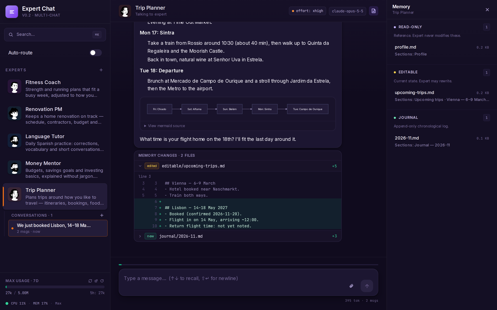

# expert-chat

**Your own team of Claude experts that remember you.**

A finance advisor that knows your portfolio. A health coach that remembers last month's blood test. A project manager that keeps the renovation schedule. Each expert is one markdown file, and keeps its notes in plain markdown files you can read, edit and version yourself.

No API key and no per-token bill: it runs on the [Claude Code](https://docs.claude.com/en/docs/claude-code) CLI, on the Claude Pro/Max subscription you already pay for.



## Why it's nice to use

- **Experts that remember.** Each expert has its own memory folder: stable facts, current state and a running journal. It reads freely and writes rarely, only when you decide something or ask it to.
- **You see every change.** When an expert updates its memory, the reply shows a diff of exactly what it wrote. No silent edits.
- **New expert in a minute.** Click **+**, describe what you need in two sentences, and Claude drafts the expert for you to review.
- **It picks the expert for you.** Turn on auto-routing and a small, fast model (Haiku) sends each message to the right expert.
- **Fast, even in long chats.** Follow-ups resume the CLI session, so the history comes from the prompt cache instead of being re-sent.
- **Don't wait, queue.** Send up to 3 more messages while a reply is still streaming.
- **More than text.** Mermaid diagrams, "Add to calendar" cards, and images, PDFs and text files via drag and drop.
- **Nothing hidden.** Thinking and tool calls stream live in a collapsible strip above each reply.
- **The everyday basics.** Multiple chats per expert, ⌘K search across all of them, edit-and-resend, regenerate, per-chat effort, per-expert model, and a usage bar for your subscription quota.

## Requirements

- Node.js 20+
- The `claude` CLI, installed and logged in with a Pro/Max subscription (`claude auth login`). `ANTHROPIC_API_KEY` is ignored on purpose, so the CLI always uses the subscription.

## Setup

```bash
git clone <this repo> expert-chat
cd expert-chat
npm install
npm run prod      # production server on http://localhost:3000
# or: npm run dev # dev server with hot reload (slower)
```

`npm run prod` rebuilds only when the code changed since the last build. Experts and memory are read at runtime, so editing them needs no rebuild.

## Your data

Everything personal lives outside this repo:

```
expert-chat/
  data/              # gitignored: keep it in its own (private) git repo
    experts/<id>.md  # one file per expert
    memory/<id>/     # readonly/, editable/, journal/ markdown files
  chats/             # gitignored: chat history and attachments
```

Set `EXPERT_CHAT_DATA_DIR` to keep `data/` somewhere else. The app starts with no experts; add one with the **+** button or by hand.

## Adding an expert

Create `data/experts/my-expert.md`:

```markdown
---
name: My Expert
description: What this expert helps with, in one sentence. Speaks English.
---

## ROLE

You are ...
```

For memory, create `data/memory/my-expert/` with `readonly/`, `editable/` and `journal/` subfolders. [`docs/creating-experts.md`](docs/creating-experts.md) is the full guide: naming, prompt structure, memory layout and a test checklist.

## Security

Experts run `claude` with `--permission-mode bypassPermissions` and only the tools the app grants: `WebFetch` and `WebSearch` always, plus `Read`/`Edit`/`Write` when the expert has memory or the chat has attachments. There is no shell tool, and MCP servers from your claude.ai account are disabled.

The memory folder is where experts are told to work, not a sandbox: `Read`/`Edit`/`Write` can reach any file the server process can, and web fetches can reach any URL. Run it in a VM or container that only holds what the experts may see.

## Docs

- [`docs/creating-experts.md`](docs/creating-experts.md): how to write an expert
- [`CLAUDE.md`](CLAUDE.md): notes for Claude Code when working on this repo

## License

[MIT](LICENSE)
